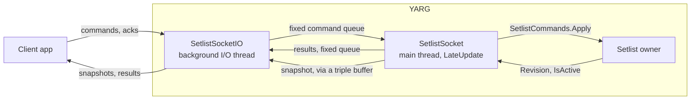

# Setlist Socket Design

Local apps can follow and edit YARG's setlist over a loopback socket. There's no web server and no steady-state garbage, socket I/O stays off the main thread, and the main thread's work is bounded each frame. The wire format is in [setlist_socket.md](setlist_socket.md).

---

## 1. Problem

People running YARG at parties want guests to queue songs from their phones ([#860](https://github.com/YARC-Official/YARG/issues/860), [#1715](https://github.com/YARC-Official/YARG/issues/1715)), and streamers want overlays that show what's up next. Today the only way for an outside app to touch the setlist is a BepInEx plugin that reads YARG's internals, which breaks whenever YARG renames something. A small supported contract lets any tool build on it across YARG versions.

---

## 2. Constraints

- **No web server in the game.** Background work during gameplay must not add GC pressure, so the transport is a small loopback socket speaking a custom protocol over plain TCP.
- **No steady-state garbage.** Every connection slot gets fixed buffers when the socket starts, snapshots and results are encoded into reused buffers, and nothing allocates per frame or per message once a client is connected.
- **Bounded main-thread work.** Socket I/O runs on one background thread, like the UDP Data Stream's, so a stalled client can't freeze the game. Clients acknowledge each snapshot before they get the next, so one that stops reading can't hold up the others. The main thread applies at most 8 commands a frame.
- **Edits only while the setlist is active.** That's while the music library is open, and through a show, including during its songs. Edits are rejected the rest of the time, not queued. Updates keep flowing either way, so overlays stay live.
- **YARG stays in charge.** Its existing rules apply: no duplicates, and songs already played or playing can't be changed. A song added mid-show must have every playing player's part, and edits are refused while players choose parts in Difficulty Select. A remote add counts the same as one from the setlist UI.
- **Same machine only.** YARG listens on `127.0.0.1` only, on fixed port 36108, so other devices can't connect. A handshake rejects anything that isn't a setlist client, such as a browser request. There's no token, because most programs that can reach loopback could edit YARG's files directly anyway; sandboxed apps and other accounts on the same PC are the exception, and the worst they could do is rearrange the setlist. Phones reach YARG through a companion app running on the same PC.
- **Opt-in.** The socket opens only while its setting is on, and it's off by default.
- **Stable contract.** The handshake negotiates a protocol version, and the operations mirror what a player can already do in the setlist UI.

---

## 3. How it works

- [`Setlist`](../Assets/Script/Playlists/Setlist.cs) owns the live setlist. `Setlist.IsActive` says whether outside apps may see and edit it (section 5). [`Setlist.Entries`](../Assets/Script/Playlists/Setlist.Entries.cs) adds entry IDs and the rule-checked edits (section 4).
- [`SetlistSocket`](../Assets/Script/Integration/Setlist%20Socket/SetlistSocket.cs) is a component on the persistent `GlobalVariables` object. Each `LateUpdate` it:
  1. takes up to 8 queued commands and applies each through [`SetlistCommands.Apply`](../Assets/Script/Playlists/SetlistCommands.cs);
  2. compares `Setlist.Revision`, `Setlist.IsActive` and `SongContainer.LibraryRevision` with what it last published (a rescan can stop songs resolving without touching the setlist), and only on a change copies each entry's ID, hash, length and title/artist/album references into a preallocated snapshot, handed over through a triple buffer so neither thread waits for the other;
  3. posts the commands' results, stamped with the revision of the snapshot that includes them.
- It polls the setting each frame instead of using a settings callback, so startup ordering and the callback pass during settings load can't start the socket twice. `OnDisable` stops it, which also covers editor script reloads.
- [`SetlistSocketIO`](../Assets/Script/Integration/Setlist%20Socket/SetlistSocketIO.cs) owns the listener, every client and one background thread. It decodes commands into fixed 64-slot rings, at most 4 queued per client and serviced from a rotating start, so one client can't occupy the queue. It never touches `SongEntry` or the library.
- [`SetlistProtocol`](../Assets/Script/Integration/Setlist%20Socket/SetlistProtocol.cs) reads and writes the frames, and maps wire values to `SetlistCommand` explicitly, so the domain enums can change without changing the protocol. Nothing in it allocates.

**Stopping** never joins the thread. `Stop` closes the listener from the main thread, which frees the port at once, and the thread closes its clients and exits on its own. A restart creates a new instance, so the two never share buffers. If the thread stops on an unexpected error, it closes the listener and `SetlistSocket` starts a new one 10 seconds later.

---

## 4. Entry IDs and edits

Commands name setlist entries by stable IDs rather than positions, so the show advancing or two people editing at once can't make a song land in the wrong place. Each entry gets a `u32` that never repeats while YARG runs. IDs are separate numbers rather than song hashes, so the contract won't change if the setlist ever allows the same song twice.

**IDs are matched to songs lazily, by hash.** `Setlist` keeps the IDs in lists parallel to `Playlist.SongHashes` and re-syncs them the next time anything asks. So the setlist UI keeps editing through `Playlist.AddSong`, `MoveSongUp` and the rest, and sorts and rescans keep rewriting `SongHashes`, without knowing IDs exist, and songs keep their IDs through all of them. A rescan's hash replacements are applied to the ID bookkeeping too, so a renamed song keeps its ID.

**Remote edits go through `TryAdd`, `TryRemove`, `TryMove` and `ClearUpcoming`**, which enforce the rules in the protocol doc and return a `SetlistEditResult`. The setlist UI doesn't use them yet: its edits can't break those rules (it can't edit during a show), and moving it over would change UI code this feature doesn't otherwise need. It's a natural follow-up.

**Part compatibility.** Difficulty Select limits each player's choices to the parts every song in the setlist has, and gameplay assumes those parts exist. Its checks moved from private helpers in `DifficultySelectMenu` into [`ShowCompatibility`](../Assets/Script/Playlists/ShowCompatibility.cs), unchanged, so a mid-show add can be checked the same way.

---

## 5. When the setlist is active

The setlist exists only while the music library is open and during a show. Leaving the library clears it, and every load of the menu scene resets it, including after a show ends and after a single song played from the library. So every snapshot says whether the setlist is active:

| State | When | Edits from clients |
| :--- | :--- | :--- |
| `active` | The music library is the open menu, or a show is in progress, from Start Set through the last score screen | Applied within the per-frame cap, including during a show's songs |
| `inactive` | Everywhere else, such as the main menu, career, practice, replays, and a single song including its Difficulty Select | Rejected. Clients see an empty setlist. |

Edits aren't queued while the setlist is inactive. Otherwise songs a guest added from the main menu would show up the next time the host opened the library, which is the kind of surprise the setlist's clearing exists to prevent.

`MenuManager` reports the top of its menu stack after every push and pop, rather than the library reporting its own `OnEnable`/`OnDisable`, because `ReactivateCurrentMenu` turns the library off for a frame and back on, which would flash inactive. Start Set marks the show as playing before it opens Difficulty Select, so a show never passes through an inactive gap.

---

## 6. Changes to existing behavior

Remote edits can arrive while menus that show the setlist are open, so these follow them:

- **Music library** ([`MusicLibraryMenu`](../Assets/Script/Menu/MusicLibrary/MusicLibraryMenu.cs)): a view that shows the setlist (Show mode, the setlist's playlist view, or the playlist list with its "Current Setlist" row) redraws when `Setlist.ContentRevision` moves, at most every 250 ms and not while a popup, dialog or the Filters overlay is open. The library's own edits redraw at once and record the revision, so they don't redraw twice.
- **Navigation scheme:** `OnSetlistChanged` now marks the scheme for refresh and `Update` applies it, at most every 250 ms, instead of rebuilding it inline. A client flipping the setlist between empty and not could otherwise rebuild the scheme and help bar several times a frame, cancelling a hold on Start Set. `IsNavigationSchemeBlocked` now counts the Filters overlay, which pushes its own scheme.
- **Added To Setlist toast:** a remote add in the library shows the library's usual toast, at most once every 3 seconds.
- **Score screen** ([`ScoreScreenMenu`](../Assets/Script/Menu/ScoreScreen/ScoreScreenMenu.cs)): End Early is shown or hidden again when an edit changes whether a song follows.
- **Pause menu** ([`SetlistPause`](../Assets/Script/Gameplay/HUD/Pause/SetlistPause.cs)): Skip follows `Setlist.HasNext` live. It's toggled with `SetActive` and stays in its navigation group, and [`NavigationGroup.InsertNavigatable`](../Assets/Script/Menu/Navigation/NavigationGroup.cs) adds it in sibling order when it first appears, keeping the selection.
- **`Playlist.MoveSongDown`** ignores a song that isn't in the playlist, like `MoveSongUp` already did, since a client can remove a song the setlist view still shows.

---

## 7. Garbage and main-thread cost

- **Per frame, nothing changed and no commands:** four comparisons against the last published values.
- **Per command:** a few linear passes over the setlist (syncing IDs, finding its entries and the current song). At most 8 a frame.
- **Per frame, something changed:** the setlist is resolved into a reused list and each entry's fields are copied by reference into the snapshot, one more linear pass.
- **Socket thread:** each snapshot is encoded once into a reused 64 KB buffer and sent to each ready client; results go through a reused buffer. UTF-8 encoding is hand-written, because `Encoding.UTF8.GetBytes` throws when the destination is too small and allocates a fallback buffer for lone surrogates. Ack tokens come from a `RandomNumberGenerator` that refills a reused buffer 64 tokens at a time.
- **Outside gameplay:** `Setlist.Changed` subscribers in the library, score screen and pause menu can allocate (for example `Setlist.HasNext` resolves the setlist). They only run while those menus are open, never during unpaused gameplay.
- **Measured** on the Mono 6.13 runtime that ships with Unity 6000.3.5f2: with an external client sending a command every 5 ms for 20 s (2,659 answered), the heap grew by a one-off 2.9 KB and no gen0 collections ran.

---

## 8. Why acks instead of non-blocking sockets

Mono's `Socket.Send` doesn't return until every byte has been handed to the OS. That holds on non-blocking sockets too: on Unity's Mono 6.13 on Windows, a non-blocking `Send` to a client that stopped reading doesn't return a short count or `WouldBlock`, it spins at 100% CPU until the client reads again. The `IList<ArraySegment<byte>>` overload does return `WouldBlock`, but allocates 48 bytes per call.

So the socket thread never sends more than fits in the kernel's send buffer. Every frame carries a random token, and a client acknowledges by echoing the token of the last frame it read, which it can only learn by reading it. YARG keeps everything a client hasn't acknowledged under 192 KB, with a 256 KB send buffer, so every send fits at once and never waits. Changes made while a client hasn't acknowledged are folded into the next snapshot. Client sockets also get a 1 second send timeout as a backstop.

---

## 9. Alternatives considered

| Option | Why it ranks lower |
| :--- | :--- |
| Files in YARG's data folder: a state file plus a command folder | No listener, and the files are easy to inspect. A polling reader can get close to garbage-free too. But clients have to watch or poll for changes, failures leave files behind, and updates can't be pushed. |
| A full HTTP server on localhost ([#984](https://github.com/YARC-Official/YARG/pull/984)) | It allocates on every request, on thread-pool threads YARG doesn't control. Browsers can reach it, so it needs defenses against DNS rebinding and cross-site requests. |
| WebSocket framing on the same socket | Overlays and browser sources could connect directly, and standard tools could inspect it. But YARG would carry the RFC 6455 must-haves (opening handshake, masking, fragmentation, close, ping/pong), would have to check `Host` and `Origin` because browsers can connect, and the handshake allocates for SHA-1 and Base64. It can be added later if direct browser access matters. |
| Named pipe or Unix socket | The same tradeoffs as loopback TCP, plus behavior to check on every platform under Mono, and browsers can't use it either. |
| Clients edit playlist JSON directly, and YARG reloads it | YARG and the client both rewrite the whole file, so whoever writes last wins. |
| Commands name positions plus a revision | The revision bumps on every advance, so a command sent just before the next song would go stale. Stable IDs don't. |
| A new "up next" queue, separate from the setlist | It's a new gameplay feature that needs its own design. Clients can remove songs as they're played on top of the setlist. |
| Leave it to BepInEx plugins | That's how it works today. It breaks whenever YARG renames something, and it isn't supported. |

Out of scope: players and profiles, access over the LAN, and library browsing. Clients find songs through the manual song export or `songcache.bin`, so a supported library listing is a natural follow-up.
